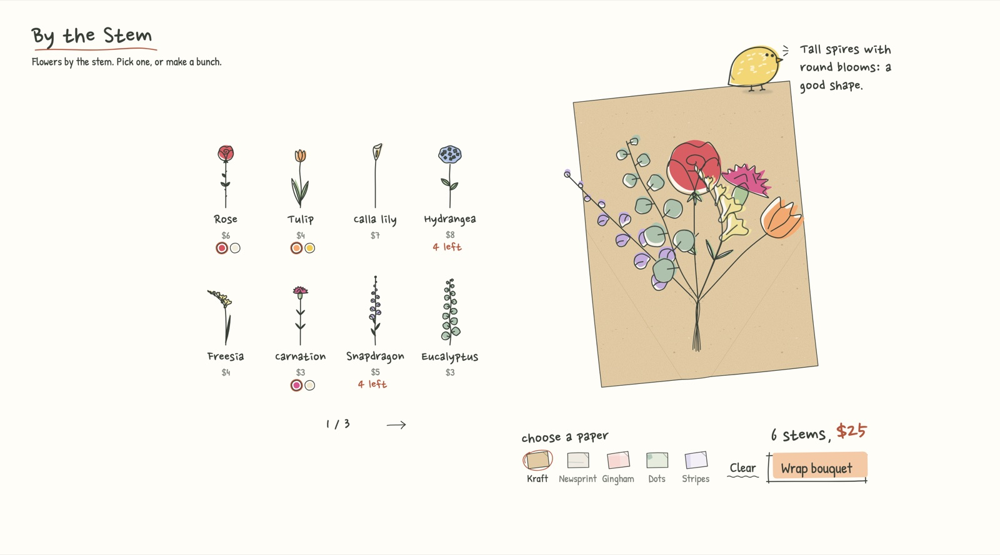
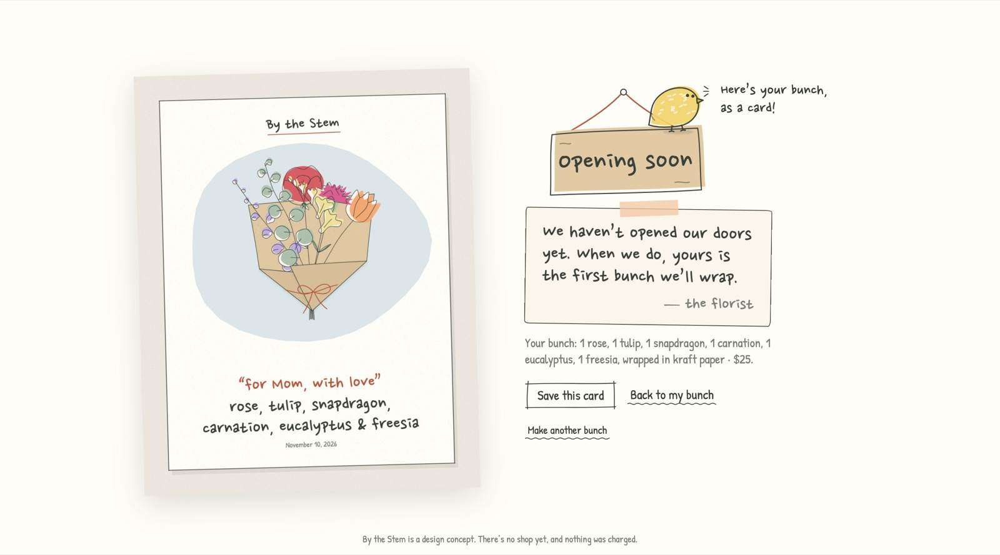

# By the Stem

**A flower shop that sells by the stem. Its front page is the wrapping bench.**

Pick single stems off the shelf, arrange them on a sheet of wrapping paper, and wrap them into a bunch that is entirely yours. The florist, a small lemon-coloured bird, keeps you company the whole way, and you leave with a card of the bunch you made.

---

## The idea

Most flower shops online sell finished bouquets from a grid of photos. In a real shop it works the other way: you point at a few stems, the florist gathers them in their hand, and the bunch takes shape in front of you.

By the Stem brings that moment online. There is no product page to browse; the first thing you see is an empty sheet of paper on the counter and a shelf of today's stems beside it.

## How it works

1. **Pick stems.** Drag a stem from the shelf onto the paper, or tap it to drop it in. There are 20 flowers over three shelf pages. A few come in two colours, and a few are running low ("4 left").
2. **Arrange.** Drag a flower to move it. Drag it lower to cut its stem shorter. Tap it to bring it to the front, or drag it off the paper to take it out. The stems always gather at one tie point, so the bunch stays a bunch.
3. **Choose a paper.** There are five hand-drawn papers: kraft, newsprint, gingham, dots and stripes.
4. **Wrap.** The paper folds around the stems, the twine ties itself, and a tag drops down.
5. **Write on the tag.** Tap the tag to write a short note, like *for Mom, with love*. The note appears on your card.
6. **Buy, and the doors aren't open yet.** "Buy this bunch" brings you to the *Opening soon* sign, where the florist lands and leaves you a note: *when we open, yours is the first bunch we'll wrap.* You take home a card of your bunch, in one of three styles.

## Design decisions

- **The homepage is the bench.** The interaction is the product, so it starts immediately, with an empty paper, a dashed flower and one line of instruction.
- **A florist, not a tutorial.** Hidden gestures such as cutting a stem, bringing a flower forward or taking it out are taught by the bird the first time they become useful, one tip at a time. After that it comments on your bunch now and then ("Tall spires with round blooms: a good shape"). It sits on the paper's corner rather than in the middle of the screen, so it never gets in the way. It flies off while you wrap and lands on the *Opening soon* sign at the end.
- **An ending that stays in the story.** Checkout doesn't end in a payment form; it ends at the shop's door. The sign says *Opening soon*, the florist promises your bunch will be the first one wrapped, and the moment becomes anticipation instead of a dead end.
- **Something to keep.** The note on the tag and the card turn a pretend purchase into something personal you might actually share.
- **One drawing language.** Every flower, paper, card and the bird is drawn the same way: a fine olive ink line with the colour printed slightly off the line, like a riso print. Hand-lettered type (Nanum Pen Script and Patrick Hand) and a calm palette keep the stems as the loudest thing on the page.
- **Grouping and breathing room.** The shelf and its pager form one group, and the paper with its paper choice, price and button form another. The bench is optically centred and scales with the window height, so it fits a laptop screen and doesn't balloon on a big monitor.

## Running it

It's a single self-contained HTML file with no build step or dependencies; fonts load from Google Fonts. Open `index.html` in a browser, or turn on GitHub Pages for this repository.

Designed for desktop and laptop screens.

## What's in the repo

| Path | What it is |
|---|---|
| `index.html` | The finished site |
| `docs/` | Screenshots used in this README |
| `explorations/` | Working pages from the design process: style samples, layout studies, flower, paper, card, pager, shopkeeper and speech options, and the first versions of the bench |

## Credits

Designed by Auria Zhang. All flowers, papers, cards and the florist bird are drawn in code as SVG and canvas.
